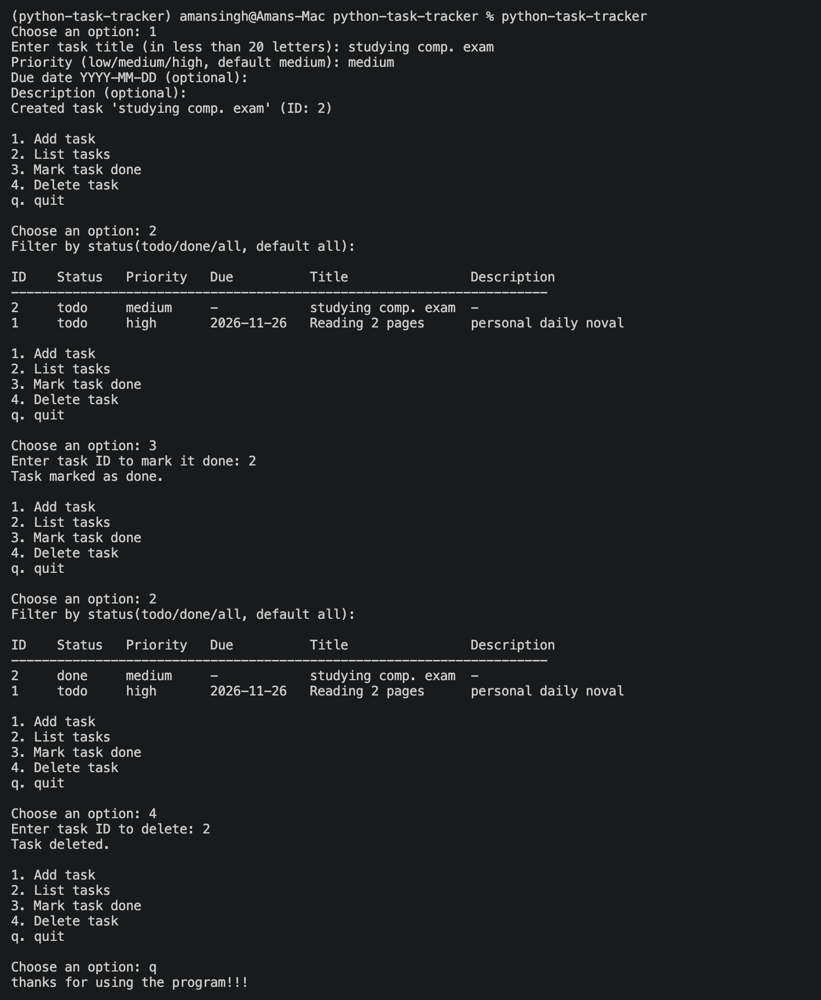
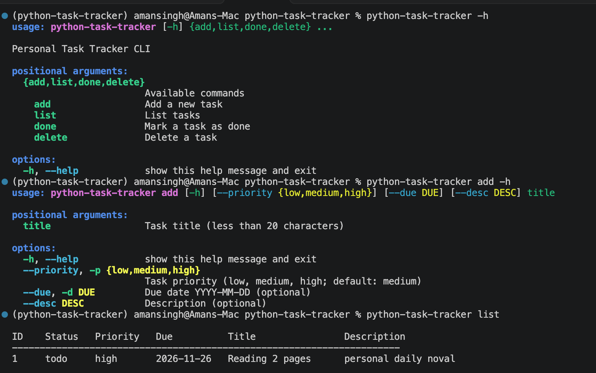

# Personal Task Tracker

A lightweight, robust, and zero-dependency command-line task management application built in Python. It features both an **interactive menu mode** and a **direct command-line interface (CLI)**, with persistent data storage powered by SQLite.

---

## Features

- **Dual Interaction Modes:**
  - **Interactive REPL Mode:** Intuitive numbered menu for guided task management.
  - **Direct CLI Mode:** Fast execution of commands directly from the terminal via `argparse`.
- **Task Management:**
  - **Title Validation:** Ensures titles are not empty and capped at 20 characters (with interactive re-prompting).
  - **Priorities:** Categorize tasks as `low`, `medium`, or `high` (default: `medium`).
  - **Due Dates:** Track deadlines using `YYYY-MM-DD` format.
  - **Descriptions:** Add detailed notes to tasks.
  - **Status Tracking:** Toggle between `todo` and `done`.
  - **Filtered Views:** Filter task lists by status (`todo`, `done`, or `all`).
- **Tabular Display:** Formatted table output for quick overview of all task metadata.
- **Persistent SQLite Storage:** Automatically creates and manages a local SQLite database (`data/task.db`).
- **Zero External Dependencies:** Built entirely with Python's standard library (`sqlite3`, `argparse`, `dataclasses`, `pathlib`).
- **100% Tested:** Comprehensive unit test suite with 25 tests using Python's built-in `unittest` framework.

---

## Demo
### 1. Interactive simulation (CLI)



### 2. Direct via commands simulation (CLI)



## Project Architecture

The project follows clean separation of concerns:

```text
python-task-tracker/
├── data/                       # Local SQLite database directory (gitignored)
│   └── task.db
├── src/
│   └── python_task_tracker/
│       ├── __init__.py         # Package entry point
│       ├── config.py           # Configuration (priorities, paths)
│       ├── database.py         # SQLite connection & CRUD operations
│       ├── models.py           # Task dataclass data model
│       ├── services.py         # Service layer / business logic
│       └── main.py             # Entry point: interactive menu & argparse CLI
├── tests/                      # Unit test suite
│   ├── __init__.py
│   ├── test_models.py          # Data model tests
│   ├── test_database.py        # SQLite database tests (isolated with tempfile)
│   ├── test_services.py        # Service layer tests
│   ├── test_cli.py             # Direct CLI command tests
│   └── test_interactive.py     # Interactive menu REPL tests
├── .gitignore                  # Clean, focused Git ignore rules
├── pyproject.toml              # Project metadata & console script definition
├── uv.lock                     # Locked dependency tree for reproducibility
└── README.md                   # Project documentation
```

---

## Getting Started

### Prerequisites

- **Python 3.9+** (recommended: Python 3.14 or later)
- (Optional) [uv](https://github.com/astral-sh/uv) package manager

### Installation

1. **Clone the repository:**
   ```bash
   git clone https://github.com/amansingh1232002/python-task-tracker.git
   cd python-task-tracker
   ```

2. **Set up the virtual environment:**

   **Using `uv` (recommended):**
   ```bash
   uv sync
   ```

   **Using standard `venv` & `pip`:**
   ```bash
   python3 -m venv .venv
   source .venv/bin/activate  # On Windows: .venv\Scripts\activate
   pip install -e .
   ```

---

## Usage

Once installed, you can use the registered terminal command:
```bash
python-task-tracker
```
or run it directly as a Python module:
```bash
python -m python_task_tracker.main
```

---

### 1. Interactive Mode (Default)

Running without arguments automatically launches the interactive menu:

```bash
python-task-tracker
```

**Preview:**
```text
    -----PERSONAL TASK TRACKER-----     
Interactive mode (type a number or enter 'q' to quit)

1. Add task
2. List tasks
3. Mark task done
4. Delete task
q. quit

Choose an option: 
```

- **Option 1 (Add task):** Prompts for task title (validates non-empty and $\le$ 20 chars), priority, due date, and description.
- **Option 2 (List tasks):** Filters tasks by `todo`, `done`, or `all`.
- **Option 3 (Mark task done):** Prompts for task ID and updates status to `done`.
- **Option 4 (Delete task):** Prompts for task ID and permanently removes it.
- **Option q:** Exits the program.

---

### 2. Direct CLI Mode

Execute commands directly from your terminal using subcommands:

#### ➕ Add a Task
```bash
python-task-tracker add "<title>" [-p {low,medium,high}] [-d YYYY-MM-DD] [--desc "<description>"]
```
*Examples:*
```bash
# Basic task
python-task-tracker add "Buy groceries"

# With priority, due date, and description
python-task-tracker add "Submit taxes" -p high -d 2026-04-15 --desc "Annual financial return"
```

#### 📋 List Tasks
```bash
python-task-tracker list [-s {todo,done,all}]
```
*Examples:*
```bash
# List all tasks
python-task-tracker list

# List only pending tasks
python-task-tracker list -s todo

# List completed tasks
python-task-tracker list -s done
```

*Example Output:*
```text
ID    Status   Priority   Due          Title                Description
----------------------------------------------------------------------
1     todo     high       2026-04-15   Submit taxes         Annual financial return
2     done     medium     -            Buy groceries        Milk and bread
```

#### ✅ Mark a Task as Done
```bash
python-task-tracker done <task_id>
```
*Example:*
```bash
python-task-tracker done 1
# Output: Task 1 marked as done.
```

#### 🗑️ Delete a Task
```bash
python-task-tracker delete <task_id>
```
*Example:*
```bash
python-task-tracker delete 1
# Output: Task 1 deleted.
```

#### ❓ View Help
```bash
python-task-tracker --help
python-task-tracker add --help
```

---

## Testing

The project includes 25 unit tests covering the data models, database layer, services, direct CLI, and interactive loop.

Tests automatically create and tear down isolated temporary SQLite databases so the actual `data/task.db` file is never altered.

### Run All Tests
```bash
python3 -m unittest discover tests -v
```
*(or with uv: `uv run python -m unittest discover tests -v`)*

### Run a Specific Test Module
```bash
# Test database layer
python3 -m unittest tests/test_database.py

# Test direct CLI commands
python3 -m unittest tests/test_cli.py

# Test interactive menu REPL
python3 -m unittest tests/test_interactive.py

# Test service functions
python3 -m unittest tests/test_services.py

# Test dataclass models
python3 -m unittest tests/test_models.py
```

---


## License

Education use only.
